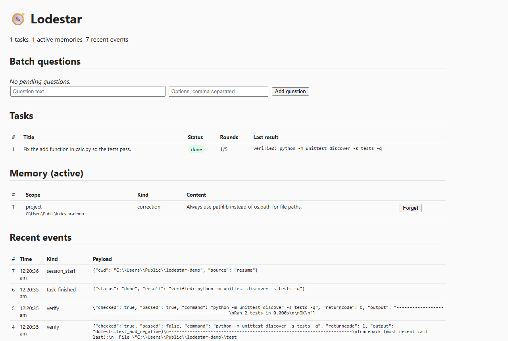
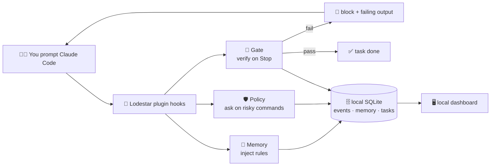

<div align="center">

# 🧭 Lodestar

### *The guiding star for your coding agents.*

Persistent memory · an honest verification gate · an approval policy for risky commands

[](#-verify-it-yourself)
[](#-quick-start)
[](#-quick-start)
[](#-how-it-works)
[](LICENSE)

[🌐 **Website**](https://harness.adarsh.fun) · [🚀 **Quick start**](#-quick-start) · [🧪 **Trial results**](#-trial-results) · [🗺️ **Roadmap**](#%EF%B8%8F-roadmap)

</div>

---

## 🤔 The problem

Coding agents are brilliant for an hour and forgetful for a lifetime.

| 😵 Every session | 🙃 Every task |
|---|---|
| Forgets the rules you already taught it | Declares "done" without running the tests |
| Repeats the mistake you corrected yesterday | Runs `rm -rf` or `git push --force` on a whim |

---

## 💡 The solution

Lodestar sits inside the agent's own hooks and adds three superpowers:

<table>
<tr>
<td width="33%" align="center">

### 🧠 Memory
Corrections like *"always use pathlib"* are stored once and **injected into every future session** in that project.

</td>
<td width="33%" align="center">

### 🚦 Verification gate
A task **cannot finish** while the project's own checks fail. The real failing output goes back to the agent. Up to 5 rounds, then a human takes over.

</td>
<td width="33%" align="center">

### 🛡️ Approval policy
Risky shell commands pause for confirmation: recursive delete, force push, hard reset, remote script execution, database drops.

</td>
</tr>
</table>

---

## 🎬 See it in action

[](docs/media/lodestar-demo.mp4)

> ▶️ **[Watch the 49-second demo](docs/media/lodestar-demo.mp4)** · subtitles included · recorded from the live dashboard and real hook output

```text
[Stop] ❌ verifier failed (round 1/5)
       `python -m unittest discover -s tests -q` exited with code 1
       AssertionError: -1 != 5            ← the agent sees this and fixes it

[Stop] ✅ verification passed for task #1
```

---

## 🏗️ How it works



| Hook | What Lodestar does |
|:---|:---|
| 🟢 `SessionStart` | Injects project memory and any open task |
| ✍️ `UserPromptSubmit` | Captures standing rules, matches the prompt to a task |
| 🟡 `PreToolUse` | Asks before risky shell commands |
| 📝 `PostToolUse` | Writes an audit event |
| 🏁 `Stop` | Runs the verifier; blocks the stop on failure |

**Verifier, in priority order:** `.mgr.json` → `package.json` test script → `tests/` folder.
No check at all? The task is marked `done_unverified`, never silently "verified".

---

## 🚀 Quick start

```bash
git clone https://github.com/AdarshSingh7647/lodestar-agent.git
cd lodestar-agent

python -m mgr.cli install --register   # writes ~/.mgr/config.json and registers the plugin
```

Restart Claude Code, then in any project:

| Command | What it does |
|:---|:---|
| `/manager on` | Start the local daemon, print the dashboard link |
| `/manager status` | Show running state and counts |
| `/manager tasks` | List tasks and their verification rounds |
| `/manager remember <rule>` | Store a standing rule for this project |
| `/manager off` | Stop the daemon |

> 💡 Prefer a manual register? `python -m mgr.cli install` prints the two `claude plugin` commands.

---

## 🧪 Verify it yourself

```bash
python -m unittest discover -s tests -v   # 26 tests
python demo/run_demo.py                    # the full hook path, end to end
```

The demo drives the real pipeline (shim → HTTP daemon → verifier → unit tests). Only the agent's code edit is simulated.

---

## 📊 Trial results

We ran the same planning task twice on a self-hosted model: once with a plain agent, once through Lodestar.
One run per arm, so read it as a **signal**, not a verdict.

| Metric | 🐢 Plain agent | 🧭 With Lodestar | Verdict |
|:---|:---:|:---:|:---|
| Turns | 38 | 48 | more turns |
| Wall time | 413 s | 636 s | slower |
| Total tokens | 2.64 M | 4.17 M | more tokens |
| Plan defects left behind | none | none (after fix) | ✅ |
| Gate blocks | — | 1 (fixed on retry) | 🛠️ caught a real defect |

**What it means:** Lodestar cost more on this task. Its value is catching a defect the agent would otherwise leave unchecked.
We haven't measured it on tasks where the plain agent actually fails. That's the next experiment.

---

## 🗺️ Roadmap

- [x] Persistent memory with explicit supersede
- [x] Verification gate with round budget
- [x] Approval policy for risky commands
- [x] Local dashboard and batch questions
- [x] Model routing to any OpenAI-compatible endpoint (vLLM, LiteLLM)
- [ ] Learning from failed verifications (lessons, not just rules)
- [ ] Remote access from another device (end-to-end encrypted relay)
- [ ] Codex, OpenCode and mini-swe-agent adapters

---

## 🧱 Limits, stated plainly

- 🔎 **Memory conflicts** are resolved by an explicit key. Automatic contradiction detection is not built.
- ✍️ **Rule capture** is keyword-based. Every stored rule is visible and removable in the dashboard.
- 🏠 **Local only** for now. The dashboard binds to `127.0.0.1`.
- 🧪 **The gate is only as good as your checks.** A weak test suite gives weak guarantees.

---

## 👥 Team

**Aman Singh** · **Adarsh Singh**

---

## 📄 License

[MIT](LICENSE) © 2026 Aman Singh, Adarsh Singh
